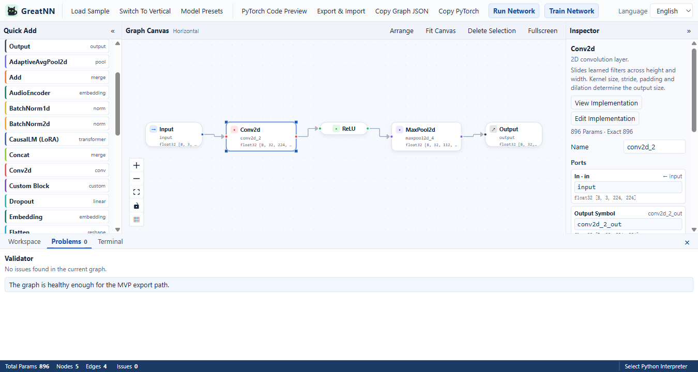

<div align="center">


<br /><br />


<h1>GreatNN</h1>
<h2><em>A visual workbench for PyTorch networks</em></h2>

<p>Build a network on the canvas, check its tensor shapes with a real batch, and run or train it in your local Python environment.</p>

<table>
<tr>
<td align="center"><strong>Graph editor</strong><br />Named ports and reusable blocks</td>
<td align="center"><strong>Model inspection</strong><br />Shapes, parameters and PyTorch code</td>
<td align="center"><strong>Local inference</strong><br />Run a graph or ask a local model</td>
<td align="center"><strong>Training</strong><br />Custom loss and LoRA adapters</td>
</tr>
</table>

<p><a href="#why-greatnn">Use cases</a> · <a href="#quick-start">Quick start</a> · <a href="#features">Features</a> · <a href="#ui-layout">Layout</a> · <a href="#presets">Presets</a> · <a href="#project-structure">Structure</a> · <a href="#roadmap">Roadmap</a> · <a href="./README_CN.md">简体中文</a></p>

</div>

<br />

<div align="center">
  
</div>

---

<a name="why-greatnn"></a>
## Why GreatNN?

| Use case | Start here |
| --- | --- |
| Trace a network | Load ResNet-18 or VGG-16 and follow the shape at each port. |
| Try a new block | Import a Python class or edit a layer on the canvas, then run a validation batch to check its output. |
| Adapt a local model | Load a compatible causal language model, choose which projections to adapt, and save the resulting LoRA adapter. |

<a name="quick-start"></a>
## Quick Start

### Windows

1. Under **Assets** on the GitHub release, download `GreatNN-0.1.0-win-x64.zip`. Extract the full folder and open `GreatNN.exe`.
2. Click **Load Sample**, choose a model preset, or add an **Input** node to the blank canvas.
3. For local execution, click the Python indicator at the bottom right and choose an interpreter with PyTorch. Open the Input node’s **Input Settings**, add your script, and click **Save and Detect**.
4. Open **Run Network** to inspect the output, or **Train Network** to choose a loss and optimizer.

The portable ZIP contains the desktop app. Install a [compatible build of PyTorch](https://pytorch.org/get-started/locally/) in the interpreter you intend to use. For package-aware Python completion, install `jedi` in that environment. For local language models and media encoders, install the packages you need:

```bash
python -m pip install jedi "transformers>=4.51,<5" "peft>=0.17,<0.19" "accelerate>=1,<2" Pillow
```

### From source

Use Node.js 22.12 or later. From the extracted source directory:

```bash
npm ci
npm run dev
```

| Command | What it does |
| --- | --- |
| `npm run dev` | Opens the desktop workspace in development mode. |
| `npm run build` | Type-checks the project and builds the app assets. |
| `npm run pack:win` | Builds a Windows installer. |
| `npm run lint` | Runs ESLint. |

<a name="features"></a>
## Features

### Graph canvas and model inspection

- Drag and connect layers, resize blocks, and rearrange the graph horizontally or vertically. Use **Fit Canvas** for a large preset.
- Give ports names before wiring the graph. Generated code uses those names, and an unnamed input follows its upstream variable by default.
- The inspector shows inferred shapes and parameter counts. After a run, it can show a selected module’s actual parameter shapes and a small sample of its weights.
- The **Problems** tab lists disconnected ports, shape mismatches, and other graph issues. The status bar shows the current Python interpreter.

### Modules and code

| Category | Examples |
| --- | --- |
| Inputs and outputs | `Input`, `Output` |
| Convolution and residual blocks | `Conv2d`, `ResidualBlock2d`, `ResNetBasicBlock`, `ResNetBottleneck` |
| Normalization, activation and pooling | `BatchNorm1d`, `BatchNorm2d`, `LayerNorm`, `ReLU`, `GELU`, `MaxPool2d`, `AdaptiveAvgPool2d` |
| Sequences and attention | `Embedding`, `LSTM`, `GRU`, `SelfAttention`, `TransformerEncoder`, `TransformerDecoder` |
| Projections and graph operations | `Linear`, `Flatten`, `Dropout`, `Add`, `Concat`, `PatchEmbedding`, `TokenPool` |
| Text and media | `Tokenizer`, `CausalLM`, `VisionEncoder`, `AudioEncoder` |
| User-defined blocks | `CustomBlock`, imported Python classes, and blocks saved to the personal library |

**View Implementation** shows the selected class or the PyTorch calls used by a built-in layer. **Edit Implementation** opens a Python editor with syntax checks and completion. For a custom block, edit `__init__` and `forward` together, then save the block to reuse it on another graph.

### Input scripts and shape detection

Define `build_inputs()` for inference-only input, or `build_datasets()` for training. A dataset returns `train`, `validation`, and `test`, and each item is an `(inputs, target)` pair. For a named input dictionary, use the names on the canvas.

For example, connect `Input → Linear → Output` and set `Linear` to one output feature. This script provides four input features and a single regression target:

```python
import torch
from torch.utils.data import TensorDataset


def build_datasets():
    rng = torch.Generator().manual_seed(42)
    features = torch.randn(120, 4, generator=rng)
    target = features.sum(dim=1, keepdim=True)
    return {
        "train": TensorDataset(features[:80], target[:80]),
        "validation": TensorDataset(features[80:100], target[80:100]),
        "test": TensorDataset(features[100:], target[100:]),
    }
```

**Save and Detect** reads a sample through the selected Python interpreter. In this example the input becomes `float32 [B, 4]` and the downstream Linear layer uses four input features. **Run Canvas** uses `build_inputs()` when present and otherwise uses the first validation batch.

### Running, training and LoRA

| Mode | Inputs and results |
| --- | --- |
| **Run Canvas** | Uses the Input node’s script and displays graph output. For a causal language model, it can decode generated tokens to text and show tensor details separately. |
| **Ask a Model** | Takes a text prompt and a local model folder. You can load a LoRA adapter before generating a reply. |
| **Train Network** | Uses the training split for updates, the validation split for the loss curve, and the test split for final loss. Set the device, optimizer, epochs, batch size, and learning rate here. |

Frozen modules still participate in the forward pass. Custom loss functions can take `prediction`, `target`, `tensors`, and `inputs`; use a name from the graph, such as `tensors["logits"]`, to read an intermediate value. Training can continue with the dialog closed and can be stopped from the training window.

The **Causal LM · LoRA** preset connects token IDs and an attention mask to a local model. Choose automatic target matching, Q/V, all four attention projections, MLP projections, or all linear layers. Rank and alpha are available in the same inspector. Local model folders need compatible weights and tokenizer files. The release was smoke-tested with a small Qwen2 configuration. There are no 7B performance figures for this release.

### Import and export

| Format | Use |
| --- | --- |
| Graph JSON | Save and reopen an editable graph, including named ports and scripts. |
| PyTorch | Preview and copy the generated `nn.Module`, or import a class from a Python source file. Imported classes can still depend on their original project. |
| ONNX | Import supported operators from `.onnx` or `.pb` files for inspection. |

The graph includes a tokenizer and separate vision and audio encoder blocks. Vision and audio blocks emit features for downstream nodes. For the audio encoder, use a 16-bit PCM WAV at the processor’s expected sample rate.

<a name="ui-layout"></a>
## UI Layout

| Region | Controls |
| --- | --- |
| Top toolbar | Sample, presets, layout, import/export, PyTorch preview, run, train, and language. |
| Left sidebar | Search built-in layers or open the personal block library. |
| Canvas | Connect, move, resize, and delete nodes. Zoom or fit the entire graph. |
| Right inspector | Named ports, upstream connections, shapes, implementation, and training mode. |
| Bottom panel | Workspace, Problems, and Terminal. The blue status bar shows graph totals and the active Python environment. |

<a name="presets"></a>
## Built-in Model Presets

| Preset | What it contains |
| --- | --- |
| Simple CNN | Starter graph with a single Input node. |
| ResNet-18 / ResNet-50 | Residual network layouts with basic blocks or bottlenecks. |
| VGG-16 | A stack of convolution and pooling layers with a classifier head. |
| LSTM Classifier | An example of sequence classification with a recurrent layer. |
| Transformer Seq2Seq | Encoder and decoder paths with separate inputs. |
| DINOv3-style ViT | A vision-transformer layout with patch embedding and token pooling. |
| Causal LM · LoRA | A graph wired for token IDs, attention mask, and a local causal model. |

Presets describe network structure. The ZIP contains no pretrained weights or datasets.

<a name="project-structure"></a>
## Project Structure

```text
GreatNN/
├── electron/           Desktop menus, Python completion, inference and training
├── public/             Mascot and Windows icons
├── src/
│   ├── core/            Graph types, import, shape inference and PyTorch export
│   ├── editor/          Canvas, inspector, code editor, run and training panels
│   └── examples/        Model presets
└── docs/                Screenshots and release notes
```

<a name="roadmap"></a>
## Roadmap

The next items to investigate are larger-model memory use, coverage of more ONNX operators, and model-specific multimodal inputs. Current support covers local causal language models and separate media encoders that can be wired into a graph.

## Tech Stack

Electron hosts the desktop app, React and React Flow provide the editor, and CodeMirror and Jedi handle Python editing and completion. Local execution uses the selected Python interpreter with PyTorch. Transformers and PEFT are used for language models and LoRA.

## License

GreatNN is based on [NNMind by NasNeo](https://github.com/NasNeo777/NNMind). The source and portable package keep the original copyright notice and MIT license in `LICENSE`. Copyright (c) 2026 NasNeo.
