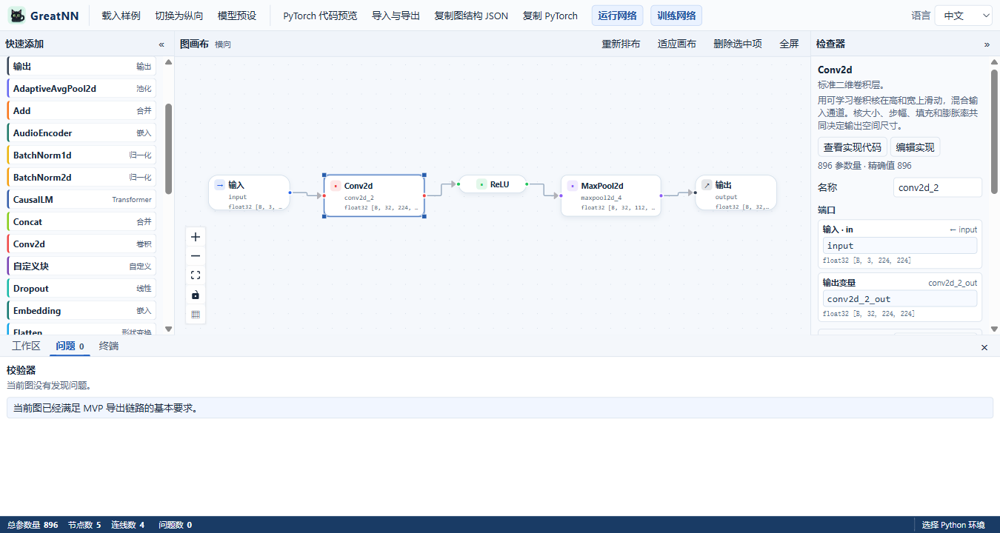

<div align="center">


<br /><br />


<h1>GreatNN</h1>
<h2><em>PyTorch 可视化工作区</em></h2>

<p>在画布上搭建网络，用真实样本核对张量形状，再用本地 Python 环境执行前向计算或训练。</p>

<table>
<tr>
<td align="center"><strong>网络画布</strong><br />命名端口和自建模块库</td>
<td align="center"><strong>模型检查</strong><br />形状、参数和 PyTorch 实现</td>
<td align="center"><strong>本地推理</strong><br />执行画布或向模型提问</td>
<td align="center"><strong>训练与微调</strong><br />自定义 LOSS 和 LoRA 适配器</td>
</tr>
</table>

<p><a href="#why-greatnn">使用场景</a> · <a href="#quick-start">快速开始</a> · <a href="#features">功能</a> · <a href="#ui-layout">界面布局</a> · <a href="#presets">模型预设</a> · <a href="#project-structure">项目结构</a> · <a href="#roadmap">后续工作</a> · <a href="./README.md">English</a></p>

</div>

<br />

<div align="center">
  
</div>

---

<a name="why-greatnn"></a>
## 使用场景

| 场景 | 从哪里开始 |
| --- | --- |
| 看懂一张网络图 | 载入 ResNet-18 或 VGG-16，顺着连线检查每一层的输入和输出形状。 |
| 试一个新的模块 | 导入 Python 类，或直接修改画布上的模块，先用一个验证批次检查结果。 |
| 微调本地模型 | 载入兼容的因果语言模型，选择 LoRA 目标层，训练后保存适配器。 |

<a name="quick-start"></a>
## 快速开始

### Windows

1. 在 GitHub Release 的 **Assets** 中下载 `GreatNN-0.1.0-win-x64.zip`，完整解压后运行 `GreatNN.exe`。
2. 点击「载入样例」，从「模型预设」选一个网络，或在空画布上手动添加输入和模块。
3. 要运行或训练时，点击右下角的 Python 状态栏，选择装有 PyTorch 的解释器。打开输入节点的「输入设置」，填写或导入脚本，点击「保存并检测」。
4. 打开「运行网络」查看输出，或打开「训练网络」设置 LOSS 和优化器。

便携包内含桌面程序。请按自己的设备安装 [PyTorch](https://pytorch.org/get-started/locally/)。要启用基于本地包的 Python 补全，请在所选解释器中安装 `jedi`。使用语言模型或图像、语音编码器时，再安装对应依赖：

```bash
python -m pip install jedi "transformers>=4.51,<5" "peft>=0.17,<0.19" "accelerate>=1,<2" Pillow
```

### 从源码运行

使用 Node.js 22.12 或更新版本，在解压后的源码目录中执行：

```bash
npm ci
npm run dev
```

| 命令 | 用途 |
| --- | --- |
| `npm run dev` | 启动桌面开发版。 |
| `npm run build` | 检查 TypeScript 并构建应用资源。 |
| `npm run pack:win` | 打包 Windows 安装程序。 |
| `npm run lint` | 运行 ESLint。 |

<a name="features"></a>
## 功能

### 网络画布与模型检查

- 拖动模块、连接端口和调整节点尺寸。预设可以横向或纵向排列，节点较多时用「适应画布」查看全图。
- 端口可以命名。生成代码使用画布里的名称，未命名的输入默认沿用上游变量名。
- 检查器显示推导出的形状和参数量。运行后可查看选中模块的实际参数名、形状和部分权重值。
- 底部「问题」面板列出未连接端口、形状不匹配等问题。右下角显示当前 Python 解释器，点击即可更换。

### 内置模块与实现代码

| 类别 | 模块示例 |
| --- | --- |
| 输入输出 | `Input`、`Output` |
| 卷积和残差 | `Conv2d`、`ResidualBlock2d`、`ResNetBasicBlock`、`ResNetBottleneck` |
| 归一化、激活和池化 | `BatchNorm1d`、`BatchNorm2d`、`LayerNorm`、`ReLU`、`GELU`、`MaxPool2d`、`AdaptiveAvgPool2d` |
| 序列和注意力 | `Embedding`、`LSTM`、`GRU`、`SelfAttention`、`TransformerEncoder`、`TransformerDecoder` |
| 投影和张量操作 | `Linear`、`Flatten`、`Dropout`、`Add`、`Concat`、`PatchEmbedding`、`TokenPool` |
| 文本和媒体 | `Tokenizer`、`CausalLM`、`VisionEncoder`、`AudioEncoder` |
| 自建模块 | 自定义块、从 Python 文件导入的类，以及固化到自建库的模块 |

「查看实现代码」会展示所选模块类或内置层的 PyTorch 调用。「编辑实现」支持 Python 语法检查和补全。自定义块可以一起编辑 `__init__` 和 `forward`，也能保存到自建库，在另一张画布上复用。

### 输入脚本与形状检测

只跑推理时，可以写 `build_inputs()`。需要训练时，写 `build_datasets()`，返回 `train`、`validation`、`test` 三个数据集，其中每项为 `(输入, 目标)`。多路输入使用字典时，键名和画布上的输入变量名一致。

例如画布连成「输入 → Linear → 输出」，把 `Linear` 的输出特征设为 1，下面的脚本会提供 4 个输入特征和 1 个回归目标：

```python
import torch
from torch.utils.data import TensorDataset


def build_datasets():
    rng = torch.Generator().manual_seed(42)
    features = torch.randn(120, 4, generator=rng)
    target = features.sum(dim=1, keepdim=True)
    return {
        "train": TensorDataset(features[:80], target[:80]),
        "validation": TensorDataset(features[80:100], target[80:100]),
        "test": TensorDataset(features[100:], target[100:]),
    }
```

点击「保存并检测」后，程序会用选中的 Python 环境读取样本。这个例子中，输入形状会同步为 `float32 [B, 4]`，下游 Linear 的输入特征也会改为 4。「运行画布」优先使用 `build_inputs()`，否则读取验证集的第一批数据。

### 运行、训练与 LoRA 微调

| 模式 | 输入与输出 |
| --- | --- |
| **运行画布** | 使用输入节点里的脚本，展示网络输出。接入因果语言模型时，可以查看解码后的文字，并展开张量详情。 |
| **大模型问答** | 选择本地模型目录，直接输入问题。生成前可以加载训练过的 LoRA 适配器。 |
| **训练网络** | 训练集用于更新参数，验证集用于绘制 LOSS 曲线，训练结束后计算测试损失。可选设备、优化器、训练轮次、批大小和学习率。 |

冻结模块仍参与前向计算。自定义 LOSS 可以接收 `prediction`、`target`、`tensors` 和 `inputs`，例如通过 `tensors["logits"]` 引用名为 `logits` 的中间张量。关闭训练窗口后任务仍可继续，也可以重新打开窗口停止。

「Causal LM · LoRA」预设连接 token ID、注意力遮罩和本地模型。目标层可选自动匹配、Q/V、全部注意力投影、MLP 投影或全部线性层，秩和缩放也可以下拉设置。模型目录需要相容的权重和分词器。当前版本用小型 Qwen2 验证了微调与保存，尚未实测 7B 的资源占用和训练速度。

### 导入与导出

| 格式 | 用途 |
| --- | --- |
| Graph JSON | 保存并重新打开可编辑的画布，保留端口名和脚本。 |
| PyTorch | 预览或复制生成的 `nn.Module`，也可从 Python 文件选一个类导入。导入后的类可能仍需原项目依赖。 |
| ONNX | 导入 `.onnx` 或 `.pb` 文件中的受支持算子，用于查看结构。 |

图上可使用分词器、图像编码器和语音编码器。图像与语音块输出特征，供下游模块继续处理。语音编码器读取采样率与处理器匹配的 16 位 PCM WAV。

<a name="ui-layout"></a>
## 界面布局

| 区域 | 内容 |
| --- | --- |
| 顶部工具栏 | 样例、预设、布局、导入导出、PyTorch 预览、运行、训练与语言切换。 |
| 左侧 | 搜索内置模块，或从自建库添加模块。 |
| 中间画布 | 接线、拖动、缩放和删除节点，或适应整张画布。 |
| 右侧检查器 | 端口名、连接来源、张量形状、实现代码和训练模式。 |
| 底部 | 「工作区」「问题」「终端」切换。蓝色状态栏显示图统计和当前 Python 环境。 |

<a name="presets"></a>
## 模型预设

| 预设 | 内容 |
| --- | --- |
| Simple CNN | 只有一个输入节点的起始画布。 |
| ResNet-18 / ResNet-50 | 使用基础残差块或瓶颈块的网络布局。 |
| VGG-16 | 卷积、池化与分类头。 |
| LSTM Classifier | 用循环层做序列分类的示例。 |
| Transformer Seq2Seq | 独立输入的编码器与解码器。 |
| DINOv3-style ViT | 带 Patch Embedding 和 Token Pooling 的视觉 Transformer 布局。 |
| Causal LM · LoRA | 为 token ID、注意力遮罩和本地模型预接好端口。 |

预设提供网络结构。便携包不附带预训练权重和数据集。

<a name="project-structure"></a>
## 项目结构

```text
GreatNN/
├── electron/           桌面菜单、Python 补全、推理与训练
├── public/             小黑猫和 Windows 图标
├── src/
│   ├── core/            图结构、导入、形状推导和 PyTorch 导出
│   ├── editor/          画布、检查器、代码编辑器、运行和训练面板
│   └── examples/        模型预设
└── docs/                截图和发布说明
```

<a name="roadmap"></a>
## 后续工作

接下来要验证的是更大模型的显存与内存占用、更多 ONNX 算子的导入，以及各家多模态模型的输入格式。当前版本可以运行本地因果语言模型，也可以把独立的图像或语音编码器接入画布。

## 技术栈

桌面端使用 Electron，画布由 React 和 React Flow 构建。Python 编辑器使用 CodeMirror 和 Jedi，运行及训练由所选解释器中的 PyTorch 执行，语言模型和 LoRA 分别使用 Transformers 和 PEFT。

## 许可证

GreatNN 基于 [NasNeo 的 NNMind](https://github.com/NasNeo777/NNMind) 修改。源码与便携包中的 `LICENSE` 保留了 MIT 许可全文及原版权声明：Copyright (c) 2026 NasNeo。
